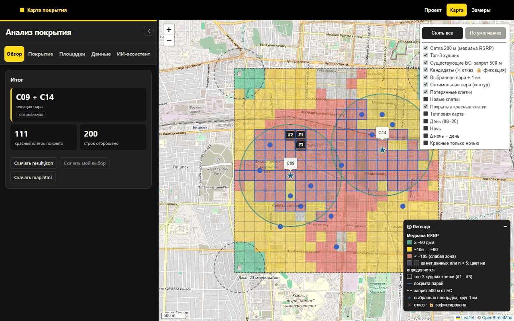

# Карта покрытия — ТЗ 7, Осенний хакатон INAI 2026

[](https://github.com/nwrbol/MapBASE_Inai/actions/workflows/ci.yml)

По замерам RSRP строим карту покрытия района Бишкека (сетка 200×200 м), находим слабые зоны и выбираем две площадки для новой базовой станции.



## Быстрый старт

Нужен Python 3.10 или новее.

```bash
pip install -r requirements.txt
```

```bash
python run.py
```

Команда читает `data/*.csv` и `data/bounds.json` и пишет в корень репозитория `result.json`, `map.html` (открывается двойным кликом, без интернета, кроме подложки OSM) и `report.json`.

Скрытый набор жюри (каталог с `measurements.csv`, `towers.csv`, `candidates.csv` и, если есть, `bounds.json`):

```bash
python run.py --data-dir path/to/hidden --out out/
```

Отдельные файлы:

```bash
python run.py --measurements m.csv --towers t.csv --candidates c.csv --bounds bounds.json --config config.yaml
```

Веб-интерфейс (FastAPI) с загрузкой своих CSV, открывается на http://127.0.0.1:8000, OpenAPI на `/docs`:

```bash
python run.py --serve
```

Деплой (Render, Railway, Heroku и т. п.): точка входа `main.py` в корне, команда запуска есть в `Procfile`:

```bash
uvicorn main:app --host 0.0.0.0 --port $PORT
```

Сводка в консоли на открытом наборе:

```
Rows total: 5000 | kept: 4800 | dropped: 200
  malformed: 15, unparseable: 15, bad_timestamp: 10, rsrp_out_of_range: 25, out_of_bounds: 30, duplicates: 105
Cells: 398 (n>=5: 387) -> green 26, yellow 187, red 174
Worst-3: X006_Y013 (-124.50), X005_Y013 (-121.40), X006_Y012 (-120.75)
Best pair (brute force): C09 + C14 -> 111 red cells covered
Greedy: C16 + C17 -> 108 (brute force better by 3)
Day/night: day 2405 rows, night 2395 rows; median delta (night - day) = 0.6 dB
Written: result.json, map.html, report.json
```

Коды выхода: `0` — успех, `2` — ошибка входных данных или конфига (понятное сообщение без traceback), `1` — прочие ошибки.

## Вход и выход

| Файл | Поля |
|---|---|
| `measurements.csv` | `lat, lon, rsrp_dbm, timestamp` (около 5000 строк, с мусором) |
| `towers.csv` | `id, lat, lon` (существующие БС) |
| `candidates.csv` | `id, lat, lon` (20 площадок) |
| `bounds.json` | границы района и начало сетки (`lat_min/lat_max/lon_min/lon_max`, `grid_origin_*`, `cell_size_m`, `earth_radius_m`, `timezone`) |

`result.json` содержит ровно 4 ключа из ТЗ. На открытом наборе он **совпадает с `data/expected.json`**:

```json
{
  "worst_cells": [
    {"cell_id": "X006_Y013", "rsrp_median": -124.5},
    {"cell_id": "X005_Y013", "rsrp_median": -121.4},
    {"cell_id": "X006_Y012", "rsrp_median": -120.75}
  ],
  "best_candidates": ["C09", "C14"],
  "dropped_rows": 200,
  "covered_weak_cells": 111
}
```

Всё дополнительное лежит в `report.json`: разбивка очистки, статистика сетки, все кандидаты со статусом допуска, ничьи, сравнение перебора и жадного алгоритма, день и ночь, параметры, время работы.

## Принятые допущения

Правила взяты из ТЗ и из `CLARIFICATIONS_RU.md` §7 (копия в [`docs/CLARIFICATIONS_RU.md`](docs/CLARIFICATIONS_RU.md)). Всё меняется в [`config.yaml`](config.yaml) без правки кода.

- **Границы района:** прямоугольник из `bounds.json`, границы включительно. Если `bounds.json` нет, берутся такие же значения из `config.yaml`. Поддержан и полигон (`bounds.polygon`, ray casting).
- **Данные не чинятся, а отбрасываются:** перепутанные lat/lon, `-95 dBm`, `NaN`, `Infinity`, пустые значения не исправляются.
- **Причины отбрасывания** (строка считается по первой сработавшей): пустая физическая строка или неверное число полей → нечисловые/бесконечные `lat, lon, rsrp_dbm` → `timestamp` не ISO 8601 → RSRP вне `[-140, -44]` (обе границы допустимы) → вне границ района → дубль.
- **Дубль:** совпадение четырёх нормализованных полей `lat, lon, rsrp_dbm, timestamp`: числа сравниваются как числа (`-95` = `-95.0`), время как момент (`…T13:58:30+06:00` = `…T07:58:30Z`). Первое вхождение остаётся. Поиск дублей идёт среди строк, прошедших остальные фильтры, поэтому порядок на итог не влияет.
- **`dropped_rows`** = все строки данных файла (включая пустые) минус оставленные.
- **Время без смещения** считается местным (`Asia/Bishkek`).
- **Сетка:** локальная равнопромежуточная проекция от `grid_origin` (юго-западный угол): `x = R·cos(lat0)·rad(lon−lon0)`, `y = R·rad(lat−lat0)`, `R = 6371000`, `cell = (floor(x/200), floor(y/200))`, `cell_id = X{ix:03d}_Y{iy:03d}`. Точки на максимальной границе попадают в клетку по `floor`, индекс не обрезается.
- **Клетка учитывается**, если в ней не меньше 5 замеров; иначе она исключается из цветов, топ-3 и покрытия.
- **Цвета:** зелёный при медиане ≥ −90, жёлтый при −105 ≤ медиана < −90 (ровно −105 жёлтый), красный при < −105.
- **`worst_cells`:** сортировка по медиане по возрастанию, затем по `cell_id`; формат `{cell_id, rsrp_median}` (`worst.format`: `objects` / `id` / `latlon`).
- **Допуск площадки:** расстояние до каждой БС ≥ 500 м (ровно 500 допускается).
- **Покрытие:** гаверсинус от площадки до **центра** красной клетки ≤ 1000 м (включительно).
- **Выбор пары:** полный перебор всех пар допустимых площадок, максимум размера объединения (без двойного учёта). Ничья: лексикографически минимальная отсортированная пара id (`selection.tie_break`, альтернатива `depth_then_lexicographic`). Все ничьи пишутся в `report.json` и в лог.
- **`best_candidates`** отсортирован по возрастанию; **`covered_weak_cells`** — размер объединения.
- Меньше двух допустимых площадок: CLI не падает, в `best_candidates` то, что есть, в логе ошибка.

## Что сделано

Обязательная часть:
- [x] Очистка: дубли, RSRP вне −140…−44, координаты вне района, нечисловые и пустые значения, неверное время; вывод числа отброшенных строк с разбивкой по причинам.
- [x] Сетка 200×200 м, медиана RSRP, исключение клеток с n < 5.
- [x] Цвета зелёный / жёлтый / красный по порогам.
- [x] Топ-3 худших клеток.
- [x] Выбор двух площадок: гаверсинус, радиус 1 км, запрет ближе 500 м к БС, без двойного учёта.
- [x] HTML-карта на Leaflet (`map.html`, полностью автономная) и `result.json`.
- [x] Запуск одной командой, коды выхода, понятные ошибки.

Бонусы:
- [x] Жадный алгоритм против полного перебора: таблица на карте, время, шаги жадного; на открытом наборе перебор лучше на 3 клетки (111 против 108). Есть юнит-тест, где жадный проигрывает.
- [x] День и ночь: отдельные сетки (n ≥ 5), доли цветов, Δ медиан по общим клеткам, клетки «красные только ночью/днём», слои «День», «Ночь», «Δ ночь − день», «Красные только ночью».
- [x] Тепловая карта (leaflet.heat), ярче там, где сигнал слабее.

Сверх ТЗ:
- [x] FastAPI: загрузка своих CSV через форму, пересчёт с параметрами (размер клетки, радиусы, пороги), скачивание `result.json` и `map.html`, GeoJSON сетки, OpenAPI.
- [x] Самопроверка на грязных данных (`make selfcheck`).
- [x] 66 тестов, ruff, CI на Python 3.10 и 3.12, Dockerfile.

## Что не успели

- Нет загрузки GeoJSON-полигона района через веб-форму (полигон задаётся только в `config.yaml`).
- Дробные секунды длиннее 6 знаков усекаются до микросекунд (на дубли не влияет в реальных данных).
- CI гоняется только на Linux; на Windows запуск вручную не проверяли (зависимость `tzdata` добавлена для часового пояса).

## Архитектура

```
CSV ─► io (чтение строками, валидация столбцов)
     ─► cleaning (причины отбрасывания, дубли) ─► CleaningReport
     ─► grid (проекция, floor(x/200), медиана, n ≥ 5, цвет) ─► топ-3, красные клетки
     ─► selection (допуск 500 м, покрытие 1 км, перебор пар, жадный)
     ─► result.json / report.json / map.html
```

| Модуль | Что делает |
|---|---|
| `run.py` | CLI: одна команда для жюри, сводка, коды выхода, `--serve` |
| `coverage/config.py` | `config.yaml` → `Settings` (dataclass), применение `bounds.json`, валидация |
| `coverage/io.py` | чтение CSV модулем `csv` (пустые строки тоже строки), проверка столбцов и кодировки |
| `coverage/timeutil.py` | строгий разбор ISO 8601, местное время Бишкека |
| `coverage/cleaning.py` | очистка и `CleaningReport` с разбивкой причин |
| `coverage/geo.py` | гаверсинус, локальная проекция туда и обратно, point-in-polygon |
| `coverage/grid.py` | сетка, медиана, фильтр n ≥ 5, классы, топ-3 |
| `coverage/selection.py` | допуск площадок, покрытие, полный перебор и жадный алгоритм |
| `coverage/daynight.py` | бонус: день и ночь |
| `coverage/result.py` | `result.json` (ровно 4 ключа) и запись JSON |
| `coverage/render.py` | данные для карты и автономный `map.html` (Leaflet встраивается) |
| `coverage/pipeline.py` | `run_pipeline()` — одна функция для CLI и API |
| `api/` | FastAPI: эндпоинты, Pydantic-схемы, обработка ошибок → 422 |
| `web/` | шаблон страницы, `app.js` (общий для обоих режимов), стили, Leaflet 1.9.4 и leaflet.heat локально |

CLI и API вызывают одну и ту же `run_pipeline`, поэтому результаты всегда совпадают. Ядро `coverage/` не зависит от FastAPI: для `python run.py` веб-зависимости не нужны.

### API

| Метод | Путь | Что возвращает |
|---|---|---|
| GET | `/` | интерактивная карта |
| GET | `/health` | `{"status": "ok"}` |
| GET | `/api/result`, `/api/report` | `result.json`, `report.json` для `data/` |
| GET | `/api/grid` | GeoJSON клеток (`cell_id, n, median_rsrp, cls, is_worst, covered`) |
| GET | `/api/towers`, `/api/candidates` | БС; кандидаты со статусом допуска и покрытием |
| GET | `/api/heatmap`, `/api/daynight`, `/api/compare` | бонусы |
| POST | `/api/analyze` | multipart: 3 CSV (+ `bounds.json`, параметры) → полный результат; ошибки 422 |
| GET | `/api/download/result.json`, `/api/download/map.html` | скачивание (`?analysis_id=` для загруженных данных) |

## Тесты и самопроверка

```bash
make test        # pytest: 66 тестов
make lint        # ruff check + ruff format --check
make selfcheck   # грязный набор «как у жюри»
```

Тесты покрывают каждую причину очистки (границы −140/−44 остаются, −140.1/−43.9 отбрасываются, `-95` и `-95.0` — дубль, битый timestamp, пустые строки), попадание на границу клетки, медиану при чётном и нечётном n, n = 4 и n = 5, цвета на −90/−90.01/−105/−105.01, площадку на 499 и 500 м, покрытие на 1000 м включительно, объединение без двойного учёта, ничьи, случай, где жадный проигрывает, меньше двух допустимых площадок, end-to-end на фикстуре с ручным ответом и на открытом наборе против `expected.json`, детерминизм, CLI (коды 0 и 2), API (включая 422).

Результат `make selfcheck` (в открытый набор внедрено 36 мусорных строк и 3 граничные строки, которые должны остаться):

```
Injected garbage: {'duplicates_exact': 8, 'duplicates_reformatted': 6, 'rsrp_out_of_range': 6, 'out_of_bounds': 4, 'unparseable': 5, 'bad_timestamp': 3, 'malformed': 4} (total 36); boundary rows kept: 3
[OK] dropped_rows 236 == baseline 200 + injected 36
[OK] kept boundary rows: +3 kept
[OK] best pair stable: ['C09', 'C14'] -> ['C09', 'C14']
[OK] worst-3 overlap 3/3 (нужно >= 2)
SELF-CHECK PASSED
```

## Зависимости

`requirements.txt` задаёт совместимые диапазоны (проверено на Python 3.10 с pandas 2.3 / numpy 2.2 и на Python 3.13 с pandas 3.0 / numpy 2.5). Точные версии прогона — в `requirements-lock.txt`. Тяжёлых гео-библиотек нет: Leaflet подключён напрямую из `web/static/vendor/`.

Сценарий демо и ответы на вопросы жюри: [`docs/DEMO.md`](docs/DEMO.md).
